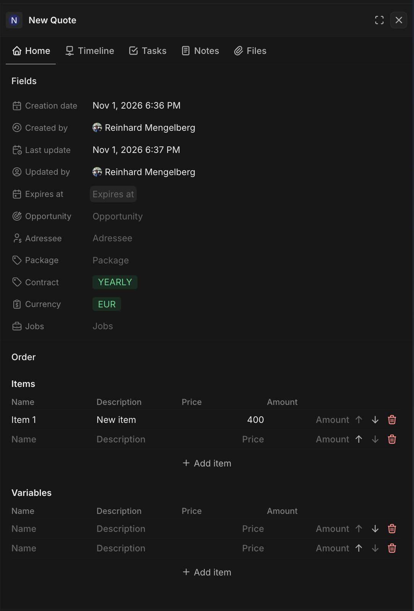
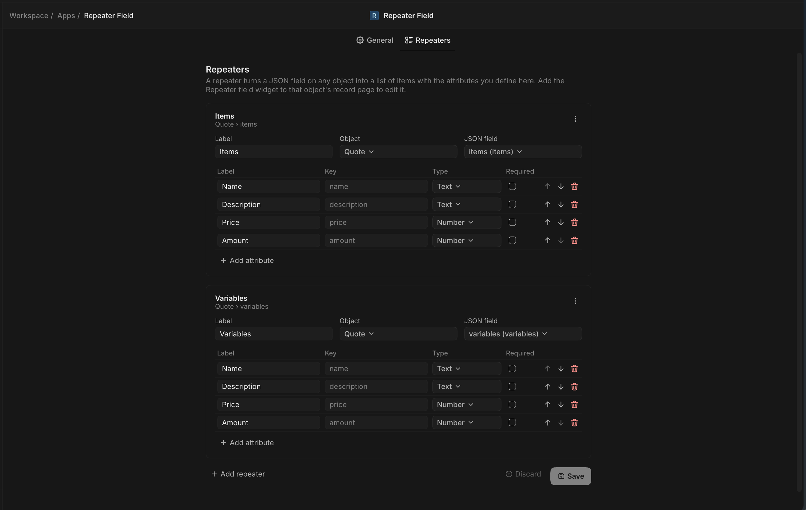

# Repeater Field

Turn a JSON field on any Twenty object into a repeater: a list of items whose attributes you define in settings.

## Screenshots

  
   <em>Repeater widget on a record page</em>

  
   <em>Defining repeaters and their attributes in settings</em>

## Features

- Repeaters on any object, each bound to a RAW_JSON field (pick one or create it from settings)
- Attribute types: text, number, currency, percent, yes/no, select, date; required flags
- Record-page widget with add, reorder, delete, discard and save
- Data stays plain JSON on the record; removed attributes keep their values

## Getting started

Deployment and configuration: [DEPLOY.md](DEPLOY.md).

## Publishing

The `Publish` workflow (`.github/workflows/publish.yml`) publishes the app to npm with provenance using [npm trusted publishing](https://docs.npmjs.com/trusted-publishers). To publish:

1. On npmjs.com register this repository as a trusted publisher of your package, pointing at the `publish.yml` workflow.
2. Bump the version in `package.json`, then push a version tag (e.g. `git tag v1.0.0 && git push --tags`) or run the workflow manually from the Actions tab.

Publishing with provenance is also how you prove ownership when claiming your app in a Twenty marketplace.

## Changelog

Notable changes are documented in [CHANGELOG.md](CHANGELOG.md).

## Learn more

- [Twenty Apps documentation](https://docs.twenty.com/developers/extend/apps/getting-started/quick-start)
- [twenty-sdk CLI reference](https://www.npmjs.com/package/twenty-sdk)
- [Discord](https://discord.gg/cx5n4Jzs57)
